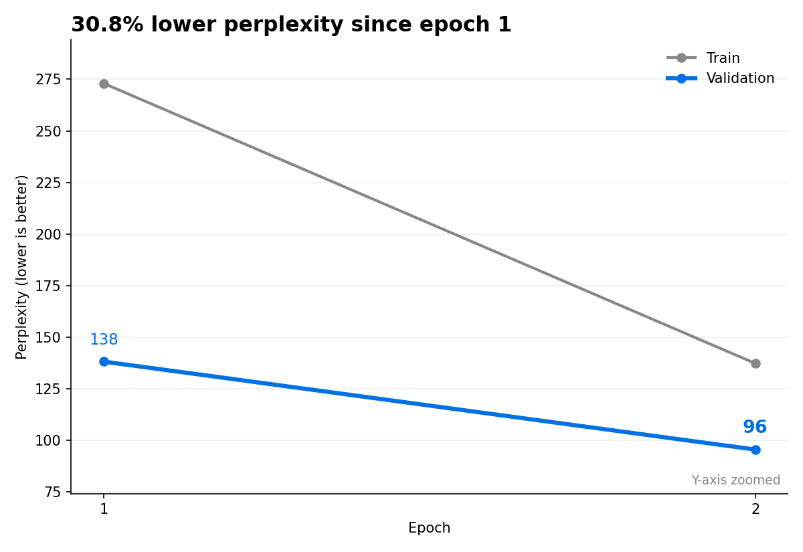
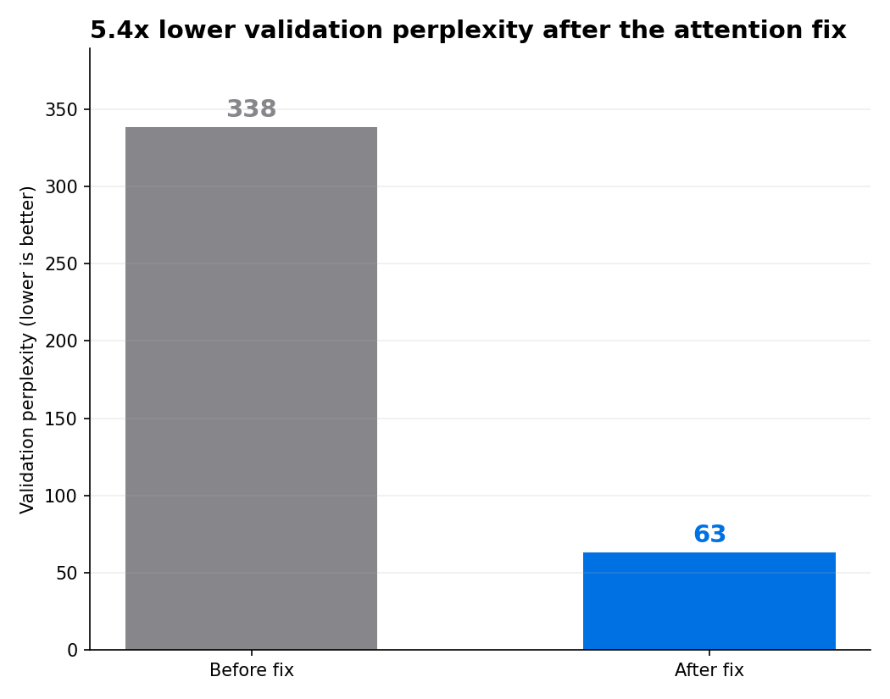

# LLM Training Pipeline (MiniGPT)

A proof-of-concept, end-to-end pipeline for training a small GPT-style language model on a cleaned
subset of English Wikipedia. Built to understand and explain the full lifecycle behind modern LLMs:
**dataset → cleaning → tokenization → training → checkpointing/logging → text generation →
evaluation**.

**Results:** a 15M-parameter model trained on 519M tokens on a single consumer GPU. Validation
perplexity fell from **137 to 63** over 7 epochs, about **5.4x lower** than an earlier version of
the model before a key attention bug was fixed.

---

## Why this exists

I built this as a "from scratch" LLM proof of concept to prove I could, and to develop the same kind
of practical understanding I previously built through a graduate computer vision project. With LLMs
being so prominent right now, I wanted to be able to describe them clearly, from the training
pipeline up.

---

## Results



Perplexity is e raised to the cross-entropy loss. It roughly measures how many tokens the model is
choosing between at each step, so lower is better. A model guessing at random over this 50,000-token
vocabulary scores 50,000.

| Epoch | Train loss | Val loss | Val perplexity |
| ----- | ---------- | -------- | -------------- |
| 1     | 5.61       | 4.92     | 137            |
| 4     | 4.53       | 4.29     | 73             |
| 7     | 4.32       | 4.14     | 63             |

Validation loss is still falling at epoch 7, with no sign of overfitting. Gains are shrinking each
epoch, which is expected for a model this size: most of its parameters sit in the embedding and
output layers, with only about 2.4M in the transformer layers themselves.

Training loss sits above validation loss for two reasons. Training loss is averaged across the whole
epoch, including the weaker early batches, while validation is measured at the end. Dropout is also
active during training and off during evaluation.

### The attention fix



An earlier version of the model plateaued at a validation perplexity of about 338 after 18 epochs.
The cause was a dimension mix-up: `nn.TransformerEncoderLayer` defaults to `batch_first=False`, but
the model passed tensors shaped `(batch, sequence, embedding)`. PyTorch read the batch dimension as
the sequence, so attention compared tokens across different samples instead of within each sequence.
There was also no causal mask.

The fix was setting `batch_first=True` and adding a causal mask so each token attends only to
earlier tokens in its own sequence. A controlled test confirmed it: on a synthetic copy task that is
only solvable with working attention, the old model scored at chance level and the fixed model
scored 100%. Retrained from scratch, the fixed model passed the old plateau within its first epoch.

---

## Repository layout

- `wikipedia_llm.ipynb`: main notebook (data prep, tokenization, model, training, generation,
  charts)
- `tokenizer/`: Byte-Level BPE artifacts (`vocab.json`, `merges.txt`)
- `tokenizer_hf/`: exported Hugging Face tokenizer format (reloadable via `from_pretrained`)
- `training_log.csv`: training and validation loss per epoch for the fixed model
- `training_log_before_fix.csv`: loss history from the model before the attention fix
- `training_perplexity.png`, `before_after_fix.png`: result charts generated by the notebook
- `environment.yml`, `requirements.txt`: environment setup for conda or pip

Model checkpoints (`checkpoint.pt`) and the encoded dataset (`train.pt`) are excluded from the repo
because of their size. The notebook regenerates both.

---

## Key features

- **Dataset ingestion (Hugging Face Datasets)** and **custom cleaning**
- **Byte-Level BPE tokenizer** (loaded from `tokenizer/`, exported to `tokenizer_hf/`)
- **Next-token prediction dataset** built from a long token stream and sliced into fixed windows
- **Causal transformer** with batch-first attention
- **Crash-safe checkpointing and resume**: checkpoints are written to a temporary file and swapped
  in only once complete
- **Consistent validation**: a fixed random seed keeps the same validation set across training
  sessions
- **Durable CSV logging** (`training_log.csv` with flush + fsync)
- **Text generation** with **temperature** and **top-k** sampling
- **Result charts**: perplexity by epoch and a before-and-after comparison

---

## What I built vs. what I used

### Built in this project

- Checkpointing (save + resume) with protection against interrupted saves
- Training metric logging to CSV (durable writes)
- Data cleaning and preprocessing
- Dataset slicing into fixed-length sequences for next-token prediction
- Sampling-based text generation helper
- Diagnosis and fix of the attention bug, plus the test that verified it
- Perplexity and comparison charts

### Libraries relied on

- **Hugging Face Datasets**: dataset access (Wikipedia snapshot)
- **PyTorch**: model and training primitives, plus the **AdamW** optimizer
- **tokenizers / transformers**: Byte-Level BPE tokenizer + `PreTrainedTokenizerFast` wrapper
- **matplotlib**: result charts

---

## How it works

### 1) Data: Wikipedia subset + cleaning

The notebook loads a subset of English Wikipedia:

- dataset: `wikimedia/wikipedia`
- config: `20231101.en`
- split: `train[:10%]`

Then it:

- removes wiki-style headings (e.g., `== Heading ==`)
- removes bracketed content (often citations)
- normalizes whitespace
- filters out short entries (keeps text over 200 characters)

This leaves about 625K articles.

### 2) Tokenization: Byte-Level BPE

A Byte-Level BPE tokenizer with a 50,000-token vocabulary is loaded from:

- `tokenizer/vocab.json`
- `tokenizer/merges.txt`

It is then wrapped as a Hugging Face fast tokenizer and saved to `tokenizer_hf/`.

### 3) Build a next-token dataset

Each article is tokenized, followed by an end-of-text token, and everything is concatenated into one
stream of 519M tokens saved to `train.pt`. Later sessions load this file instead of re-encoding. The
stream is sliced into fixed-length blocks:

- `block_size = 1024`
- inputs `x = ids[start:end]`
- targets `y = ids[start+1:end+1]`

### 4) Model: MiniGPT (small transformer)

- token + positional embeddings
- 4 `nn.TransformerEncoderLayer` blocks with `batch_first=True` and a causal mask
- layer norm + linear head to vocabulary logits

Default config:

- `n_embd = 128`
- `n_layer = 4`
- `nhead = 4`
- `block_size = 1024`
- about 15.3M parameters

### 5) Training: resume + durable logging

- `AdamW(lr=3e-4)` and `CrossEntropyLoss`
- batch size 10, one epoch per run
- 90/10 train/validation split with a fixed seed
- optimizer state restored from the checkpoint on resume
- checkpoint saved before each log entry, so the log never records an epoch without a checkpoint
  behind it

Each epoch takes roughly an hour on an RTX 5070 Ti.

---

## Quickstart

### 1) Create the environment

With conda (recommended, since it also installs the CUDA libraries):

```bash
conda env create -f environment.yml
conda activate llm
```

Or with pip:

```bash
python -m venv .venv
source .venv/bin/activate  # macOS/Linux
pip install -r requirements.txt
```

### 2) Confirm the GPU is supported

```bash
python -c "import torch; print(torch.cuda.is_available(), torch.cuda.get_arch_list())"
```

The first value should be `True`, and the list should include your GPU's architecture (for example,
`sm_120` for RTX 50-series cards).

### 3) Run the notebook

Open `wikipedia_llm.ipynb`, set `TRAINING_MODE = True`, and run all cells. Each run trains one
epoch. To continue training, run the checkpoint cell and then the training cell again.

---

## Hardware notes (NVIDIA Blackwell)

This project was developed on an RTX 5070 Ti early in the Blackwell lifecycle. The model code was
rarely the problem. The blockers were driver, CUDA, and PyTorch support catching up.

- **Check the build, not just the version.** PyTorch can report CUDA as available yet ship without
  kernels for your GPU. `torch.cuda.get_arch_list()` shows which architectures a build supports.
  Blackwell needs `sm_120`, which requires a build made with CUDA 12.8 or newer.
- **Conda-forge builds vary.** Pinning an older CUDA version can make conda fall back to a build
  without Blackwell support. Requesting a current CUDA build (for example, `"pytorch=*=cuda129*"`)
  avoids it.
- **WSL memory limits.** WSL gets half of system RAM by default, and encoding 519M tokens needs more
  than that. Raising the limit in `.wslconfig` (for example, `memory=24GB` on a 32 GB machine)
  stopped the kernel from being killed.

**Key lesson:** for brand-new GPU architectures, verify the full stack (driver, CUDA, framework
build) before launching long runs.

---

## Quick interview answers

### 1) What was the goal of this project?

Build a proof-of-concept LLM end-to-end to prove I could, and to develop the same kind of practical
understanding I previously built through a graduate computer vision project. With LLMs being so
prominent right now, I wanted to be able to explain them clearly from the training pipeline up.

### 2) What did you build vs. what libraries did you rely on?

I implemented the practical training infrastructure, including crash-safe checkpointing and durable
logging, plus the data cleaning workflow and evaluation charts. Hugging Face provided the raw
dataset access, and PyTorch provided the training primitives and AdamW optimizer.

### 3) What was the biggest technical challenge, and how did you solve it?

The hardest part was getting training working on an NVIDIA Blackwell GPU early in its lifecycle,
when support across the driver, CUDA, and PyTorch stack was still catching up. PyTorch could report
CUDA as available yet ship without kernels for the card, so I learned to check
`torch.cuda.get_arch_list()` for `sm_120` rather than trusting the version number. I resolved it by
aligning the NVIDIA driver, CUDA version, and a PyTorch build compiled with Blackwell support, then
validating GPU operations before launching multi-hour training runs.

### 4) If you had one more week, what would you improve next?

First, I'd move the training code out of the notebook into a command-line script, so a run could
start with one command and settings like epochs and batch size could change without editing code.
Then I'd train on more of Wikipedia. The model only saw 10% of it, and validation loss was still
falling at epoch 7, so more data is the clearest path to better results.
